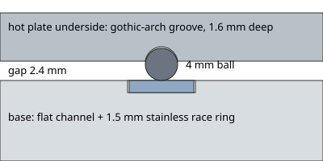

# Bed ball race

The hot plate turns on loose steel balls running in a channel cut into its
underside and a channel cut into the base, instead of a bought bearing. It's
low friction, adds almost no height, and uses the plate itself as half of the
bearing.

## Layout

All of it sits in the hot plate's outer ring, outside the Ø250 mm heater and
the ring gear (which bolts on inside it):

| | |
|---|---|
| Balls | 101 × Ø4 mm chrome steel (G25 or better) |
| Ball circle | Ø271 mm |
| Hot plate (Ø280 × 6 mm MIC-6) | **gothic-arch groove** in the underside on the ball circle: two R2.12 mm arcs, centres 0.085 mm either side of the ball's centreline, 1.6 mm deep. The two arcs touch the ball at two points, so the groove holds the balls on their circle. |
| Base | **flat-bottom channel** 8.4 mm wide × 1.5 mm deep on the ball circle, with a 1.5 mm stainless **race ring** dropped into it (flush with the base ledge) |
| Cage | 1.2 mm stainless ring with 101 Ø4.3 mm pockets, keeps the balls evenly spaced |
| Gap | the plate's underside rides 2.4 mm above the base ledge |
| Radial location | one 6806-2RS bearing (30 × 42 × 7) at the hub, around the slip ring |
| Hold-down | a wave-spring stack under the hub nut pulls the plate down onto the balls |

### Why one flat side

The hot plate is aluminium and grows by about 0.2 mm on its radius when the
bed is at 100 °C, while the base stays cool. If both sides had shaped grooves
the balls would be squeezed or go loose as the bed heats. With a flat race on
the base side, the balls simply roll a fraction of a millimetre outward with
the plate, and the hub bearing alone keeps the plate centred.

### Wear

Steel balls on aluminium will wear a track over time. Two ways to make it
last:

* Have the hot plate's underside **hard-anodised** after the groove is cut.
* Or cut the groove 0.6 mm wider and press in two **Ø1.5 mm hardened race
  wires** (spring-steel wire formed into rings) for the balls to run on, the
  way wire-race bearings are made.

The base side already runs on stainless.

## Files

| File | |
|---|---|
| `orva_race_ring.dxf` | race ring for the base channel: ID 263 / OD 279 mm, cut from 1.5 mm 304 stainless |
| `orva_race_cage.dxf` | ball cage: ID 266 / OD 276 mm with 101 pockets, cut from 1.2 mm stainless |
| `orva_race_section.svg` | cross-section for whoever machines the plate and base |
| `make_bed_race.py` | regenerates all of the above; `--ball`, `--ball-circle`, `--plate-dia` change the size |

The race ring and cage can go in the same laser-cutting order as the ring
gear.

## Assembly

1. Machine the groove in the hot plate's underside and the channel in the
   base (both concentric with the hub bore). Deburr, clean, grease lightly.
2. Drop the race ring into the base channel.
3. Fill the cage with the 101 balls and lay it on the race ring.
4. Lower the hot plate on so the balls seat in its groove, with the hub
   spigot passing through the 6806 bearing.
5. Fit the wave springs and hub nut underneath and tighten until the plate
   turns smoothly by hand with no rock at the edge.
